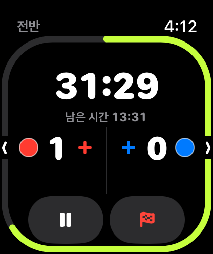
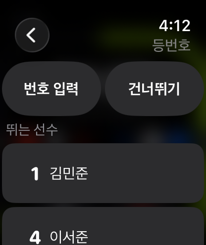
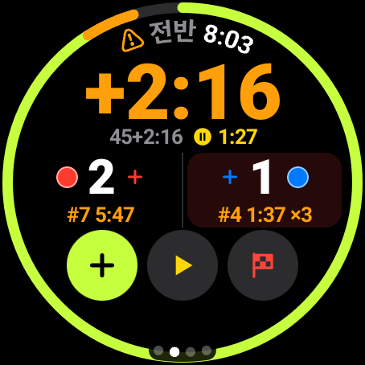
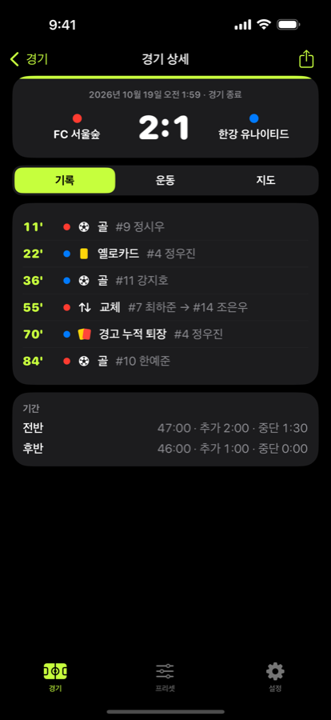
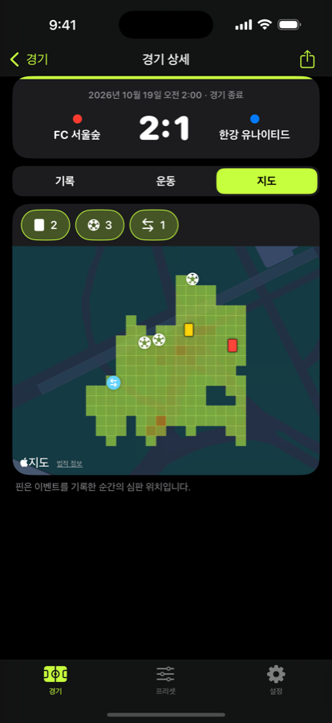
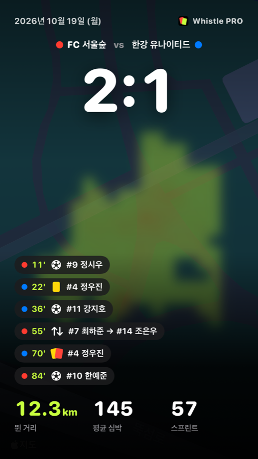
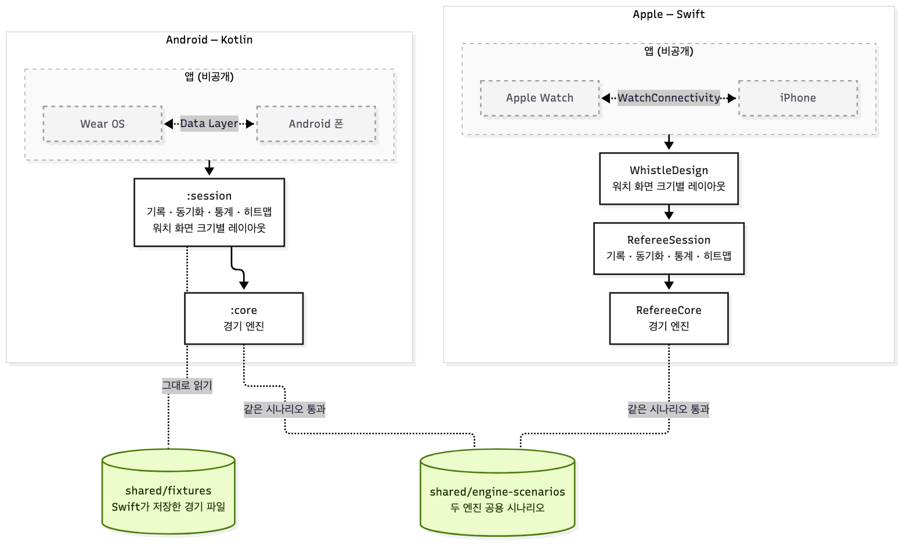

# Whistle PRO

[](https://github.com/kkt6394/Whistle-PRO/actions/workflows/test.yml)

아마추어 축구 심판용 워치 앱입니다. 심판은 워치만 차고 경기 시간·득점·경고·교체를 기록하고, 경기가 끝나면 폰에서 기록·이동 히트맵·보고서를 봅니다.
iPhone · Apple Watch · Android 폰 · Wear OS 네 앱을 1인 개발했습니다. iOS·watchOS 앱은 9개 언어로 App Store에 출시했고, Android·Wear OS 앱은 Google Play 검토 중입니다.

- App Store: [Whistle PRO](https://apps.apple.com/app/id6823503970)
- Google Play: 프로덕션 검토 중

| Apple Watch | 득점 기록 | Wear OS |
|---|---|---|
|  |  |  |

| 경기 기록 (iPhone) | 이동 히트맵 | SNS 공유 카드 |
|---|---|---|
|  |  |  |

> 이 저장소에는 **경기 엔진과 기록·동기화·통계 규칙, 그리고 그 테스트**가 있습니다. 앱 화면과 결제 연결은 비공개 저장소에 있습니다.

## 기술 스택

| | Apple | Android |
|---|---|---|
| 언어 | Swift 6 | Kotlin 2.4 (JVM 17) |
| UI | SwiftUI, Observation | Jetpack Compose, Compose for Wear OS |
| 워치 | watchOS, HealthKit 운동 세션, WatchConnectivity | Wear OS, Health Services, Wear Data Layer |
| 지도·위치 | MapKit, Core Location | Google Maps Compose, 네이버 지도(한국 위성 사진), Fused Location |
| 결제 | StoreKit 2 (자동 갱신 구독) | Google Play Billing |
| 기타 | Swift Charts, AVFoundation(경기 리플레이 영상), PDF 보고서 | Health Connect, PDF 보고서 |
| 테스트 | Swift Testing, XCUITest | JUnit 5, Compose UI 테스트 |

두 플랫폼이 함께 쓰는 것: 경기 시나리오(JSON), 9개 언어 번역 파일(언어마다 JSON 하나를 Android 빌드가 문자열 리소스로 변환).

## 전체 구조



점선 상자 안의 네 앱은 비공개이고, 나머지가 이 저장소입니다. 그림 원본은 [`docs/images/architecture.mmd`](docs/images/architecture.mmd)(mermaid)입니다.

## 설계 결정

### 일어난 일을 기록하고, 상태는 계산한다
엔진은 "현재 점수·시간"을 저장하지 않고, 심판이 한 일을 시각과 함께 순서대로 저장합니다.

```
0초      전반 시작
660초    홈팀 9번 골
1320초   원정팀 4번 경고
```

화면에 보여 줄 상태는 이 기록을 처음부터 적용해 계산합니다.

```swift
let state = MatchEngine.reduce(rules: rules, commands: commands)
```

- **화면이 꺼져도 정확한 시계:** 1초마다 세지 않고, 기록된 시각과의 차이로 경과 시간을 계산합니다.
- **앱이 꺼져도 복구:** 기록을 다시 읽어 그 시점부터 이어갑니다.
- **되돌리기·수정:** 기록을 고치고 다시 계산합니다.

### 두 플랫폼, 같은 판정
엔진 코드를 공유하지 않고 Swift와 Kotlin에 따로 두었습니다. 대신 `shared/engine-scenarios`의 같은 시나리오를 양쪽 테스트가 읽어, 같은 기록을 넣으면 같은 결과가 나오는지 CI가 매번 확인합니다. Swift가 저장한 경기 파일은 `shared/fixtures`에 두고 Kotlin이 그대로 읽는지 검사합니다.

### 워치 혼자서도 경기가 끝까지 간다
경기장에는 폰이 없거나 블루투스가 끊기는 일이 흔합니다. 워치는 끝난 경기를 보관해 두고, 폰이 "받았다"고 확인해야 지웁니다. 확인이 사라지면 다시 묻고, 폰은 같은 경기를 두 번 저장하지 않습니다. 이 판단은 플랫폼 코드와 떨어진 순수 규칙으로 두고 단위 테스트로 고정했습니다.

### 워치 화면 크기를 계산으로 맞춘다
Apple Watch 40 mm부터 49 mm, 원형 Wear OS까지 화면이 제각각입니다. 글자 크기·칸 배치를 화면별로 손으로 정하지 않고 화면 크기에서 계산합니다(Swift `WhistleDesign`, Kotlin `android/session`의 `design` 패키지). 실제 워치 화면 크기 목록으로 하한·잘림을 테스트합니다.

## 일하는 방식

설계 문서 → 작업 계획 → 구현·테스트 → 전체 리뷰 → 실기기 점검표 → 스토어 출시 순서로 진행하고, 설계·계획·구현·리뷰는 Claude Code와 나눠서 합니다. 실제 문서로 본 사례 세 가지는 **[docs/process](docs/process/)** 에 있습니다.

- [두 플랫폼 엔진 맞추기](docs/process/01-two-engines/)
- [히트맵에 경기장 넣기](docs/process/02-pitch-heatmap/)
- [워치↔폰 동기화](docs/process/03-watch-phone-sync/)

커밋 메시지는 `feat(watch):`, `fix(android):`, `test(ios):`처럼 범위를 붙입니다. 이 저장소의 커밋 기록은 비공개 본체에서 공개 경로를 건드린 커밋을 그대로 뽑은 것입니다.

본체 기준 (2026-10-31): 커밋 718개, 설계 문서 17개, 작업 계획 30개, 플랫폼별 실기기 점검표 3개.

## 출시 기록

| 날짜 (2026) | |
|---|---|
| 10-12 | 첫 커밋 — 설계와 Swift 경기 엔진 |
| 10-14 | Kotlin 엔진, 공용 시나리오로 두 엔진 맞추기 |
| 10-21 | iOS 1.0.0 App Store 심사 제출 |
| 10-25 | Android 폰·Wear OS 1.0.0 Google Play 프로덕션 검토 제출 (10-26 1.1.0으로 교체) |
| 10-28 | **App Store 1.0.0 공개** |
| 10-31 | **App Store 1.1.0 공개** — 경기장 맞추기, 팀 색 바꾸기, 경기 리플레이 영상 |

## 저장소 구성

```
apple/RefereeCore/        Swift Package
  Sources/RefereeCore       경기 시간·점수·경고·교체 판정 엔진
  Sources/RefereeSession    기록 저장, 워치↔폰 동기화 규칙, 통계, 히트맵·경기장 계산, 구독 상태
  Sources/WhistleDesign     워치 화면 크기별 레이아웃 계산
android/core              Kotlin 경기 엔진
android/session           Kotlin 기록·동기화·통계·히트맵 규칙, 워치 레이아웃 계산(design)
shared/engine-scenarios   두 엔진 공용 경기 시나리오 (JSON)
shared/fixtures           Swift가 저장한 경기 파일
docs/process              일하는 방식 사례
```

## 테스트 실행

```bash
# Swift 6 툴체인 (macOS)
swift test --package-path apple/RefereeCore

# Kotlin (JDK 17, Android SDK의 platforms;android-26 필요 — :session이 API 26 호환을 검사한다)
cd android && ./gradlew :core:test :session:test
```

---

이 저장소는 비공개 본체 저장소에서 스크립트로 내보냅니다. 직접 커밋하지 않습니다.
